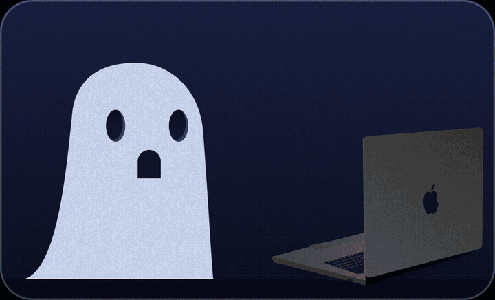
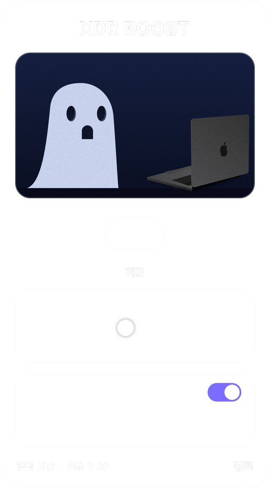
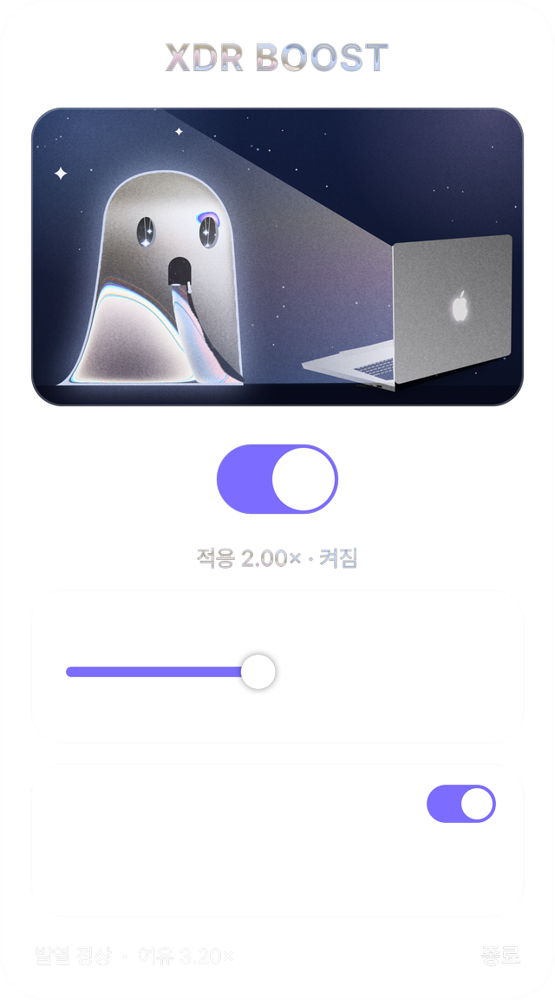

# XDR Boost — 새 맥북 디스플레이 보고 갈아탈까 고민된다면, 먼저 이걸 써보세요

[English](README.md) · **한국어**

<p align="center"></p>

> 새 맥북의 디스플레이를 보고 구매를 고민하는 바로 그 순간, 이 깃허브를 한 번 써보세요.

이번에 나온 맥북 디스플레이를 보면 바꾸고 싶어집니다. 하지만 지금 쓰는 맥북이 **Liquid Retina XDR** 디스플레이
(M1 Pro/Max 이후)라면, macOS가 일반 앱에 허락해 주는 것보다 훨씬 밝은 화면을 이미 갖고 있습니다.
XDR Boost는 평소의 **SDR** 화면을 디스플레이의 **HDR 밝기 영역(헤드룸)** 까지 끌어올려 주는 메뉴바 앱입니다.
야외처럼 밝은 곳에서 화면이 훨씬 잘 보입니다.

> 밝기만 바꿉니다. 새 패널의 다른 장점(색, 명암비, 시야각 등)을 대신해 주지는 않습니다.

https://github.com/user-attachments/assets/045e1164-e6ed-4319-80f1-151b1b4fdc64

<sub>홍보 영상 (52초, 영어). 파일은 저장소에도 있습니다: [`promo/xdr-boost-promo-small.mp4`](promo/xdr-boost-promo-small.mp4)</sub>

<p align="center"> &nbsp; </p>

## 원리

원리를 34초로 풀어 본 영상입니다(영어, 자세한 설명은 아래에 있습니다):

https://github.com/user-attachments/assets/5c02df97-60f9-469a-b94c-d5074c5938d0

1. 클릭이 통과되는 투명 창이 **내장 디스플레이**를 덮고 EDR(값 > 1.0) 콘텐츠를 그립니다.
   macOS는 이를 HDR 콘텐츠로 보고 화면을 EDR 모드로 바꿉니다.
2. EDR 모드에서 헤드룸이 열립니다(M1 Pro 기준 약 3.2×. SDR 흰색은 500nit, HDR 최대는 1,600nit).
   창은 아래 화면 전체를 배율만큼 곱합니다(`compositingFilter = "multiply"`).
3. 실제 적용 배율은 `min(설정 배율, 현재 헤드룸)`이고 0.5초마다 다시 맞춥니다. 오버레이는 계속 다시 그립니다(5fps).
   EDR 콘텐츠가 갱신되지 않으면 macOS가 SDR 밝기로 되돌리기 때문입니다.
4. 앱을 끄면 창이 사라지고 밝기가 원래대로 돌아옵니다.

배율은 선형 밝기 기준입니다(2.0× ≈ 1,000nit). 실제로 그리는 값은 `배율^(1/2.5)`이며, 채널별로 색이 잘리는 것을 막아 줍니다.

## 사용법

메뉴바의 유령 클릭 → 스위치 켜기 → 슬라이더로 밝기 조절(1.0×~3.2×).
아이콘을 오른쪽 클릭하면 일반 메뉴가 나옵니다. 패널은 macOS 26 이상에서 진짜 **Liquid Glass**,
그 이전 버전에서는 블러 배경으로 보이고, [Pretendard](https://github.com/orioncactus/pretendard) 폰트가 설치돼 있으면 그 폰트를 씁니다.

## 안전하게 설계했습니다

- 내장 디스플레이에만 적용합니다(`CGDisplayIsBuiltin`). 외부 모니터는 건드리지 않습니다.
- 열 상태가 심각해지면 자동으로 멈춥니다(끌 수 있습니다).
- 공개 API(AppKit, Metal)만 씁니다.
- 밝을수록 배터리 소모와 발열이 늘어납니다.

## 빌드

Xcode(Command Line Tools 포함)와 macOS 13 이상이 필요합니다.

```bash
./build.sh            # XDRBoost.app 생성
./build.sh install    # ~/Applications 에 설치 ("로그인 시 실행"에 필요)
./build.sh release    # 유니버설 빌드를 dist/ 에 zip
```

디버그 로그: `XDR_DEBUG=1 ./XDRBoost.app/Contents/MacOS/XDRBoost`

홍보 영상은 실제 앱 화면으로 만듭니다: `promo/make-assets.sh` 실행 후 `node promo/render.mjs`.

## 출처와 라이선스

- 곱하기 오버레이 방식은 [BrightIntosh](https://github.com/niklasr22/BrightIntosh)의 접근을 참고했습니다(코드는 직접 작성).
- 유령과 글씨의 리퀴드 메탈 효과는 [paper-design/liquid-logo](https://github.com/paper-design/liquid-logo)의 셰이더를
  Metal로 옮긴 것이며, [PolyForm Shield 1.0.0](https://polyformproject.org/licenses/shield/1.0.0) 라이선스에 따라 사용했습니다.
- 유령은 참고한 일러스트를 바탕으로 코드로 그렸습니다. Apple, MacBook, Apple 로고는 Apple Inc.의 상표이며,
  이 프로젝트는 Apple과 무관하고 Apple의 보증을 받지 않았습니다.
