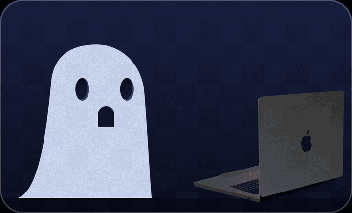

# XDR Boost — Thinking about a new MacBook for its display? Try this first.

**English** · [한국어](README.ko.md)

<p align="center"></p>

A new MacBook display can make you want to upgrade. Before you do: if you already own a MacBook Pro with a
**Liquid Retina XDR** display (M1 Pro/Max and later), it has far more brightness than macOS lets ordinary apps use.
XDR Boost is a menu bar app that pushes everyday **SDR** content into the display's **HDR headroom**, so the screen
is brighter, for example outdoors.

> It only changes brightness. It does not replace a new panel's other advantages (colour, contrast, viewing angle…).

https://github.com/user-attachments/assets/7e192ed7-0a43-49e5-8e55-1b1c20194747


## How it works

A 50-second walkthrough of the idea (the details are written out below):

https://github.com/user-attachments/assets/23a04b96-d8f8-48ae-9f8e-43a7454c816d

1. A transparent, click-through window covers the **built-in display** and draws EDR content (a value above 1.0).
   macOS sees HDR content and puts the panel into EDR mode.
2. EDR mode opens headroom (about $3.2\times$ on the M1 Pro: SDR white is 500 nits, HDR peaks at 1,600).
   The window multiplies everything beneath it (`compositingFilter = "multiply"`) by your factor.
3. The applied factor is $\min(\text{setting},\ \text{headroom})$, re-checked every 0.5 s. The overlay keeps redrawing
   (5 fps), because macOS drops EDR content back to SDR brightness once it stops updating.
4. Quit the app and the window disappears; brightness returns to normal.

The factor is in linear light (2.0× ≈ 1,000 nits). The value actually drawn is $k = L^{1/2.5}$, which keeps colours
from clipping channel by channel.

$$
\begin{aligned}
\text{headroom} &= \frac{\text{peak}}{\text{SDR white}} = \frac{1600}{500} = 3.2 \\
\text{applied} &= \min(\text{setting},\ \text{headroom}) \\
k &= L^{1/2.5}
\end{aligned}
$$

## Use it

Click the ghost in the menu bar → flip the switch → drag the slider (1.0×–3.2×).
Right-click the icon for a plain menu. The panel uses native **Liquid Glass** on macOS 26 and later
(a blurred material on older versions) and the [Pretendard](https://github.com/orioncactus/pretendard) font when installed.

## Safe by design

- Built-in display only (`CGDisplayIsBuiltin`). External monitors are never touched.
- Pauses automatically when the thermal state is serious (can be turned off).
- Public APIs only: AppKit and Metal.
- More brightness means more battery use and heat.

## Build

Needs Xcode (Command Line Tools included), macOS 13 or later.

```bash
./build.sh            # builds XDRBoost.app
./build.sh install    # copies it to ~/Applications (needed for "Launch at login")
./build.sh release    # universal build zipped into dist/
```

Debug log: `XDR_DEBUG=1 ./XDRBoost.app/Contents/MacOS/XDRBoost`

The promo video is made from the real app: `promo/make-assets.sh`, then `node promo/render.mjs`.

## Credits and licenses

- The multiply-overlay idea comes from [BrightIntosh](https://github.com/niklasr22/BrightIntosh) (approach studied, code written from scratch).
- The liquid-metal effect on the ghost and the text is a Metal port of the shader from
  [paper-design/liquid-logo](https://github.com/paper-design/liquid-logo), used under the
  [PolyForm Shield 1.0.0](https://polyformproject.org/licenses/shield/1.0.0) license.
- The ghost is drawn in code, inspired by a reference illustration. Apple, MacBook and the Apple logo are
  trademarks of Apple Inc.; this project is not affiliated with or endorsed by Apple.
